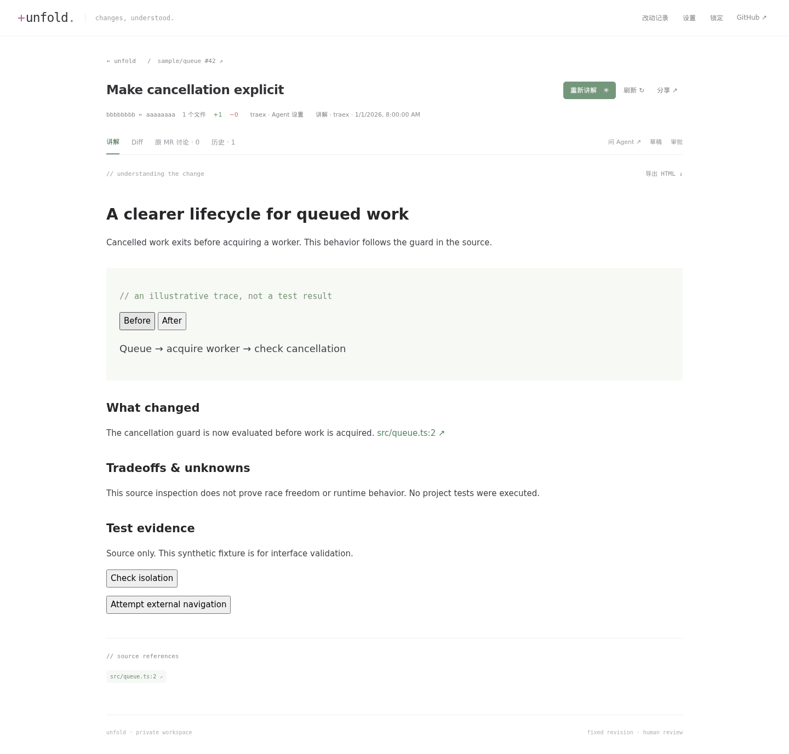
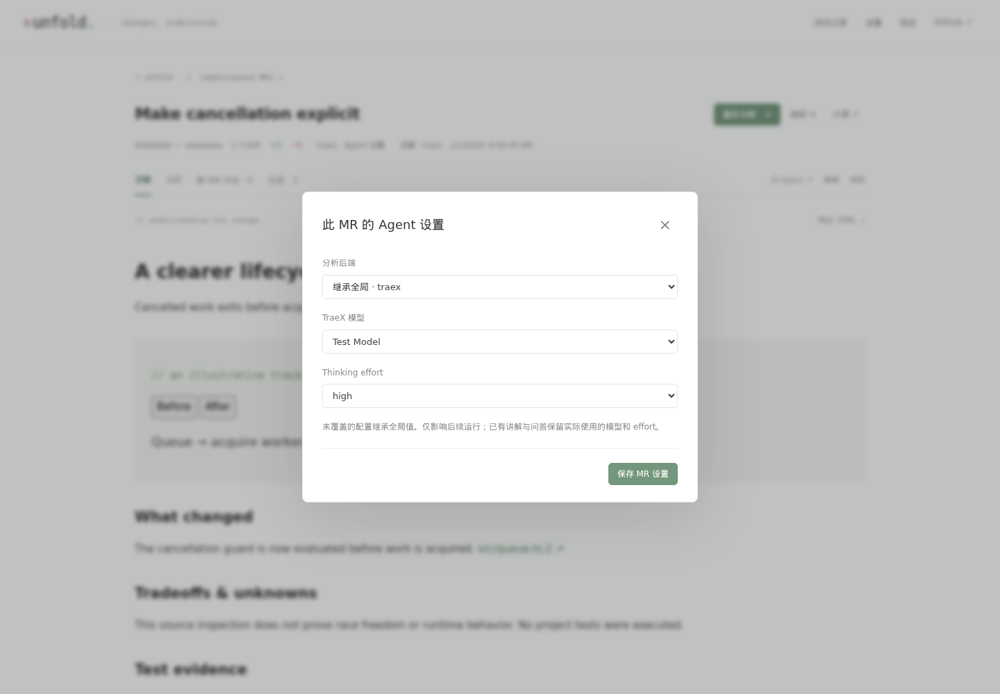

# Unfold

Understand a change before reviewing it.

Unfold reads a Codebase MR's or GitHub PR's actual source at a fixed commit, asks an existing TraeX or Codex app-server to explain its design and behavior, and presents a self-contained interactive walkthrough next to the diff. Questions stay private. Comments become editable drafts and go back to the original MR/PR only after an explicit preview and confirmation.

This is a **single-owner, CLI-first tool**. Every product operation uses the same API from the command line and the web UI. Readers can open a stable company-network URL without an account. They cannot invoke the agent, inspect private conversations, approve execution, or publish comments.

## Run locally

Requires Node.js 24+, pnpm 11, the owner's authenticated native CLIs, and Linux with bwrap for approved project execution. Docker Compose runs the web/API; a small host connector reuses existing authentication without packaging proprietary tooling or mounting it into the web container.

```sh
pnpm install
pnpm build
pnpm unfold init --codebase-host code.company.example

# Terminal 1: native connector. Keep this running on the host.
pnpm connector

# Terminal 2: owner and read-only HTTP listeners.
pnpm dev

# Or run the web/API in Compose instead of `pnpm dev`:
cp .env.example .env
# Set UNFOLD_UID/GID to `id -u` / `id -g` in .env.
docker compose up --build -d
```

Open the owner entry at `http://127.0.0.1:18371`. Retrieve the owner key deliberately with `pnpm unfold auth token`, and enter it into the sign-in form. The browser uses an HttpOnly, SameSite session cookie; the CLI reads the protected owner-key file. Do not put keys in URLs.

All runtime material is under ignored `.local/`: configuration, SQLite, generated HTML, source snapshots, investigation notes, dedicated agent homes, and receipts. It is excluded from Git **and Docker build contexts**. Original CLI credentials remain in their original stores; dedicated backend homes reuse only their authentication files. Neither proprietary CLI implementations nor their complete internal protocols are distributed here.

The **改动导览** view organizes new analyses into logical groups and individual change points, with before/after behavior, rationale, risks, pinned source evidence and scoped diffs. `unfold guide REVIEW --point g1-c1` exposes the same view data to CLI agents. Existing explanations without a guide stay readable and are not regenerated automatically.

New guide groups also describe module responsibility, suggested review checks and evidence-backed links to other modules. In **阅读范围**, choose an owner or repository path to keep overall background, relevant complete change points and the other modules needed to understand them. This uses the saved guide without another model call. `unfold guide REVIEW --owner NAME` / `--path src/` returns the same projection; `unfold share REVIEW --owner NAME` creates a read-only link pinned to that explanation and scope. A scope is a reading preference, not an access boundary.

Ownership is captured separately from the model: Codebase uses effective OWNERS rules through bytedcli, while GitHub uses the target revision's CODEOWNERS declarations. Rule paths, revisions and capture time are saved with each explanation. Unsupported or unavailable rules stay unknown and path selection remains available. Team names are preserved without expanding membership or claiming approval permissions. Older explanations are not backfilled; their existing path-based guide remains usable. See [scope and ownership CLI details](docs/cli.md#modules-and-reading-scopes).

New investigations show public agent progress, current source activity, elapsed time and per-run token usage in the owner UI. Progress and usage survive refreshes and restarts; CLI agents can inspect `unfold run RUN --json` or observe `unfold watch RUN`. Full explanation HTML lives in an artifact file, while SQLite stores metadata and its relative path. Back up `.local/data/` as a whole, including the database and artifacts.

New analyses and private answers use the bundled [chineseplz](https://github.com/M0gician/chineseplz) `write-plain-chinese` skill, including progress messages and logical change guides. Its rules favor concrete, direct Chinese while preserving technical terms, facts and uncertainty. Both backends receive the same pinned text on every turn, including resumed conversations; CLI and Web share this behavior. Writing rules apply within the existing generation, and old explanations stay unchanged. Runs and explanations retain the skill revision and effective instruction hash in `writingStyle` metadata.

## Codebase and GitHub

```sh
pnpm unfold --json import https://code.company.example/team/repo/merge_requests/42
pnpm unfold --json show REVIEW_ID
pnpm unfold --json analyze REVIEW_ID --backend traex --wait
pnpm unfold --json ask REVIEW_ID --body 'Why does cancellation happen here?' --wait
pnpm unfold --json history REVIEW_ID
pnpm unfold export REVIEW_ID --output /tmp/explanation.html
```

The fixed review ID identifies the source instance, repository and MR number. Re-importing opens the same review. Each successful explanation retains its immutable commit range. New commits mark older explanations stale; a failed regeneration keeps the last successful explanation readable.

New analyses save the overview, logical change groups and HTML as small numbered parts through a scoped native tool. The final model response only confirms completion; Unfold assembles and validates the whole explanation before publishing. The run panel and `watch` retain saved-part counts after reload. Failed/interrupted parts remain private and can be inspected with `unfold --json artifact RUN_ID` or `unfold --json artifact RUN_ID --content`. Parts do not execute, appear on share links or automatically resume an interrupted operation. A model can still exhaust its reasoning/output budget before saving a part; segmentation reduces the all-at-once artifact requirement without guaranteeing every model succeeds.

Copied MR subpage links such as `/checks`, nested job pages, `/changes` and `/activity` normalize to the canonical MR URL; query strings and fragments do not create separate reviews. The review page shows Agent, model and thinking effort dropdowns directly beside “生成讲解” / “重新讲解”. Changes automatically save as MR settings and apply to subsequent analysis and questions; generation starts with one click. Global defaults remain unchanged, and each dropdown supports inheritance. Model and effort choices come from the selected backend's real catalog. Unsupported effort resets to the new model’s default when switching models. Models without effort support receive no effort parameter. Failed saves keep the controls editable and block generation until resolved. CLI equivalents are `unfold backend REVIEW_ID BACKEND` and `unfold agent set REVIEW_ID --backend BACKEND --model MODEL --effort high`.

Choose the global default in Settings or with `unfold config set defaultBackend '"codex"'`. `unfold backend REVIEW_ID codex` changes that review's default. Use `unfold agent models traex` or `unfold agent models codex` to list actual models and supported thinking efforts. `unfold agent defaults BACKEND --model MODEL --effort high` changes global defaults; `unfold agent set REVIEW_ID --backend BACKEND --model MODEL --effort medium` adds review overrides. Both are also available in workspace Settings and the review’s inline controls. `unfold agent set REVIEW_ID --backend BACKEND --model-default-effort` saves the selected model’s own default effort, independent of global effort; `--inherit-model`, `--inherit-effort`, and `unfold backend REVIEW_ID inherit` restore inheritance. Run-level `--model` / `--effort` flags affect only that operation. Saved settings apply automatically; an active operation finishes with its original settings before the connector switches. The settings dialog and `unfold config status` report application status, including readiness failures. A run's backend/model/effort/version are recorded; there is no silent fallback. Private questions use a persistent backend-specific conversation and carry the selected version and context.

GitHub PRs use the connector host's existing `gh` CLI login. Run `gh auth login --hostname github.com` on that host, then import a `https://github.com/OWNER/REPO/pull/NUMBER` URL in the Web UI or CLI:

```sh
pnpm unfold --json doctor
pnpm unfold --json import https://github.com/OWNER/REPO/pull/NUMBER
pnpm unfold --json analyze REVIEW_ID --backend codex --wait
```

Both providers share source/Diff, analysis, private questions, guide/history/export, version-bound comment previews and publication, and fixed read-only links. Backend/model/effort selection is independent of source. GitHub reads use an immutable merge-base/head comparison; sources come from regular UTF-8 Git blobs at those commits, including fork PRs. Ordinary comments, submitted review summaries and inline replies refresh from GitHub; pending review drafts stay private. Comment writes do not submit existing pending reviews. GitHub.com is supported; Enterprise hosts are not configured by this adapter. The compare API caps file lists at 300, so larger/incomplete comparisons fail explicitly. Missing or truncated patches cannot receive inline comments. See [GitHub setup and limits](docs/github.md).

## Comment deliberately

```sh
pnpm unfold --json reference REVIEW_ID src/example.ts --version VERSION_ID --start 42
pnpm unfold --json draft create REVIEW_ID --reference REFERENCE_ID --body-file comment.md
pnpm unfold --json draft preview DRAFT_ID
pnpm unfold --json draft publish DRAFT_ID --confirm EXACT_PREVIEW_DIGEST
pnpm unfold --json refresh REVIEW_ID
```

Omit `--reference` for a general comment. Native inline comments require a location in the selected diff and are pinned to its base/head. A changed revision or edited draft invalidates the preview. A general comment is an explicit choice, never a silent fallback to a new line number. `draft edit --general` explicitly relocates an editable draft to the latest version as a general comment.

Each comment contains the owner's text, revision and relevant source location. The explanation URL is supplementary. A transport timeout is **unknown**, not a failure that can safely be retried: `draft reconcile DRAFT_ID` reads the original platform for the persisted publication marker. Original-platform drafts are never batch-published.

## Read-only sharing and Tailscale

Set `shareBaseUrl` to a company-network HTTP(S) entry and bind the read-only host port to the corresponding interface. For Compose, use `UNFOLD_SHARE_BIND` in `.env`. Then `unfold share REVIEW_ID` returns the stable URL; `--explanation EXPLANATION_ID` selects a historical walkthrough.

The share listener registers only public read routes. Private questions, drafts, agent sessions and execution receipts are unavailable there, even with an owner credential. Source access is limited to evidence included in a published explanation. No account/team/role system is involved.

Tailscale is **owner access only**, independently configured on the host:

```sh
tailscale serve --bg --https=18371 http://127.0.0.1:18371
```

Do not enable Funnel. Tailscale and localhost URLs are rejected as share-base addresses. Use `--server OWNER_URL` for a remote CLI; company sharing never falls back to that URL.

## Execution boundary

The agent receives version-bound source tools. Native shell/unified execution, inherited hooks/plugins/MCP, automatic web search and environment access are disabled. The app-server's code-mode dispatcher remains enabled because it routes the restricted host functions; it is not permission to execute reviewed code.

Running a test, build, dependency installer or repository script requires approval of an exact request containing command, revision, working directory, purpose, side effects, network access and timeout. `unfold approval list` displays requests. `approval approve ID --confirm DIGEST` grants that operation once; `approval deny` declines it. A credential-free disposable work copy executes through bwrap, with networking off unless explicitly requested and approved. The original checkout is never mounted writable. No commit, push, approve, merge or resolve-discussion operations are exposed.

Generated HTML runs in an opaque-origin `sandbox="allow-scripts"` iframe with a restrictive CSP, no remote resources and a parent navigation policy. Its only bridge selects a verified code reference or a bounded text quote in the host. It cannot invoke the agent, approve execution, or publish a comment. Exported HTML retains the sandbox wrapper.

## CLI and development

For post-submission automation, install the bundled [unfold-review skill](plugins/unfold/skills/unfold-review/SKILL.md) or [Unfold Codex plugin](plugins/unfold). The helper refreshes the MR, checks the exact submitted head, prepares or reuses its explanation, and returns a verified read-only URL pinned to that explanation. The calling agent can pass its short forwarding message to an authorized company review-chat workflow. Setup, installation, CLI options and an automatic post-submission project instruction are in [the agent integration guide](docs/agent-integration.md).

Bind the existing deployment once with the helper's `configure --server OWNER_API_URL --token-file PRIVATE_KEY_FILE --cli UNFOLD_EXECUTABLE` command, then use `check` to verify authentication. The skill and plugin share a protected per-user `~/.config/unfold/client.json` reference file across repositories and upgrades. Token contents stay in the original key file; no service address or credential is packaged on GitHub.

See [the CLI reference](docs/cli.md) for commands, JSON output, event waiting and exit codes. `--body-file -` accepts stdin. `--wait` stops at a terminal result or pending approval, with an operation ID that can be resumed using `watch` after a decision. Waiting uses an event stream, not model-driven polling.

```sh
pnpm check
pnpm test:e2e
```

Tests use synthetic source and platform responses. They do not count as real backend generation, real platform writeback, or company-network visitor proof. Live investigation and acceptance receipts belong in `.local/`; report these categories separately.

## 参考与致谢 · References & acknowledgements

- [antfu/pulls.review](https://github.com/antfu/pulls.review): logical grouping of changes, reviewer-oriented reading, and the restrained source-reading interface that inspired Unfold's visual direction.
- [cursor/plugins — PR Review Canvas](https://github.com/cursor/plugins/tree/main/pr-review-canvas): explanations organized around core behavior, execution paths, concrete before/after examples, and review risks.
- [nicobailon/visual-explainer](https://github.com/nicobailon/visual-explainer): expressive, self-contained technical explanations using HTML, diagrams and useful interaction.
- [M0gician/chineseplz](https://github.com/M0gician/chineseplz): direct, precise Chinese for explanations, change points, progress and private answers. Unfold bundles its original skill and example documents at commit `8993f98573f0cd0a8d2053741006bc38d4972b75` under MIT, with its [license](src/skills/chineseplz/LICENSE) and [source manifest](src/skills/chineseplz/ORIGIN.json).

Thank you to their authors and contributors. Unfold's application and renderer code are original; the bundled chineseplz writing documents retain their upstream MIT license and attribution. The reference projects' platforms and agent frameworks are not bundled. Any future code reuse must retain its upstream license and attribution.

Unfold is available under the [MIT license](LICENSE).

## Interface preview

The screenshots below use synthetic source and test data only.





One agent operation runs at a time. The owner workspace shows the running review with a progress link and prevents another analysis or question from starting until the slot is free. `unfold --json activity` exposes the same state; an unexpected simultaneous request returns `agent_busy` with the active run ID. Settings remain editable on other reviews.
